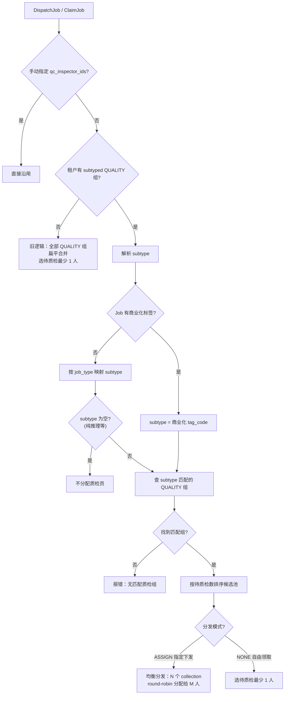

# 数采质检分发策略优化 — 技术设计方案

## 1. 背景与目标

### 1.1 现状痛点

888888 租户当前质检分发从全部 QUALITY 小组合并成员池中随机/最少待检选 1 人，不区分任务类型。组长需持续人工重分发，调度成本随人员规模扩大而上升。

### 1.2 本期目标

- **仅针对 888888 租户**，将质检分发从"扁平随机"升级为"按任务类型匹配质检小组 + 均衡分发"。
- 其他租户保持现有逻辑不变，零 breaking change。
- 无本体侧：仅增强公共租户的全局质检统计展示，不改变质检执行租户。

### 1.3 后续规划（本期不做）

- 质检员工作带宽上限（过量不分发）。
- 质检员人员异动（请假/离职）自动释放/替换。
- 扩展到其他租户。

---

## 2. 匹配逻辑

### 2.1 双分支匹配

分发质检员时，先判断 Job 是否绑定"商业化"标签，走标签匹配；否则按 `job_type` 匹配。

```
888888 租户分发时：
│
├── Job 有"商业化"标签？
│   ├── 是 → 匹配 subtype = 商业化 tag_code 的 QUALITY 组
│   └── 否 → 按 job_type 映射
│       ├── job_type=1     (数采自由)          → subtype = assigned_free
│       ├── job_type=2,4,8 (数采定制/生成/恢复) → subtype = assigned_directed
│       ├── job_type=32    (推理接管)           → subtype = inference_takeover
│       ├── job_type=64    (推理评测)           → subtype = evaluation
│       ├── job_type=128   (强化学习)           → subtype = reinforcement
│       └── job_type=16    (纯推理)             → 不分配质检员
```

> 注：`job_type=16`（纯推理）在 [job_mode.go](../../internal/biz/job_mode.go) 中 `QCInspectorIDsRequirement = sliceRequirementForbidden`，不参与质检分发。

### 2.2 subtype 值域约定

`tb_group.subtype` 为 `VARCHAR(64)` 自由文本字段，值域约定如下：

| subtype 值 | 匹配来源 | 对应质检组 | 对应 job_type |
|-----------|---------|-----------|--------------|
| 商业化标签的 `tag_code` | Job 标签 | 质检-商业化 | 任意（标签优先） |
| `assigned_free` | job_type | 质检-数采(自由领取) | 1 |
| `assigned_directed` | job_type | 质检-数采(指定下发) | 2, 4, 8 |
| `inference_takeover` | job_type | 质检-推理论管 | 32 |
| `evaluation` | job_type | 质检-推理评测 | 64 |
| `reinforcement` | job_type | 质检-强化学习 | 128 |

**扩展约定**：后续新增任务类型时，只需在 `jobTypeToSubtype` 映射函数中增加一个 case，并通过 Group API 创建对应 subtype 的 QUALITY 组即可。无需改表结构、无需写脚本。

### 2.3 匹配失败处理

- Job 有"商业化"标签但找不到 `subtype` 匹配的 QUALITY 组 → **报错拒绝分发**。
- Job 无"商业化"标签，按 job_type 匹配但找不到对应组 → **报错拒绝分发**。
- 不做模糊兜底，强制要求每种类型都有对应配置的质检组。

---

## 3. 租户 Gating 机制

不硬编码租户 ID，通过检测 QUALITY 组是否有 `subtype` 配置来自动决定走新逻辑还是旧逻辑：

```
分发时：
├── 当前租户的 QUALITY 组中存在 subtype IS NOT NULL 的组？
│   ├── 是 → 走新匹配逻辑（按 subtype 匹配 + 均衡分发）
│   └── 否 → 走旧逻辑（全部 QUALITY 组扁平合并 + 最少待检选 1 人）
```

- 其他租户的 QUALITY 组 `subtype` 都是 `NULL`，自动走旧逻辑。
- 后续其他租户要启用，只需通过 Group API 给他们的 QUALITY 组补 `subtype`。
- 回滚：清空 subtype 即回退到旧逻辑。

---

## 4. 配置方式

### 4.1 唯一配置入口：Group API

在现有 Group Create/Edit API 中新增 `subtype` 字段，运营人员通过 Web 端小组管理页面即可配置：

```protobuf
// CreateGroupRequest 新增字段
message CreateGroupRequest {
  string name = 1;
  string type = 2;
  repeated string leaders = 3;
  repeated string member_list = 4;
  string subtype = 5;  // 子类型（仅 QUALITY 类型有效）
}

// EditGroupRequest 新增字段
message EditGroupRequest {
  int64 id = 1;
  string name = 2;
  string type = 3;
  repeated string leaders = 4;
  repeated string member_list = 5;
  string subtype = 6;  // 子类型
}

// GroupInfo 新增字段
message GroupInfo {
  // ... 现有字段 1-10 ...
  string subtype = 11;  // 子类型
}
```

后端校验规则：
- 仅 `type=QUALITY` 时允许设置 `subtype`，其他类型忽略。
- `subtype` 为可选字段，不传则为空（兼容旧逻辑）。

### 4.2 初始配置

888888 租户需创建 6 个 QUALITY 组并设置对应 subtype。通过现有 Group API 完成：

1. `POST /api/group/v1/create` 创建组，或 `POST /api/group/v1/edit` 给现有组设置 subtype。
2. `POST /api/group/v1/list` 验证配置结果。

无需额外脚本或配置文件，全部通过已有 API 完成。

### 4.3 回滚

通过 `POST /api/group/v1/edit` 将 subtype 传空值即可。自动检测机制立即回退到旧逻辑。

---

## 5. 均衡分发

### 5.1 当前逻辑

`pickLeastPendingQCInspectorIDs` 从全部 QUALITY 组成员池中选 1 人（待质检最少者）。分发时所有 collection 共用同一组质检员。

### 5.2 改造目标

多个 collection 均衡分配给多个质检员，每人数量差不超过 1。参考现有脚本 [redispatch_qc_lib.py#assign_qcs_evenly](../../scripts/no_body_qc_redispatch/redispatch_qc_lib.py#L334-L349) 的 round-robin 模式。

### 5.3 分发时机

| 任务模式 | 分发时机 | 行为 |
|---------|---------|------|
| 指定下发（ASSIGN） | DispatchJob 时 | N 个 collection round-robin 均衡分配给 M 人 |
| 自由领取（NONE） | ClaimJob 时 | 按 subtype 匹配组 + 选待质检最少 1 人 |

---

## 6. 数据模型变更

### 6.1 表结构

```sql
ALTER TABLE `tb_group`
  ADD COLUMN `subtype` VARCHAR(64) DEFAULT NULL
  COMMENT '子类型：QUALITY 组按任务类型/标签匹配质检员。值域见 qc-distribution-strategy-design.md'
  AFTER `type`;

ALTER TABLE `tb_group`
  ADD INDEX `idx_tenant_type_subtype` (`tenant_id`, `type`, `subtype`);
```

### 6.2 Biz 层

```go
// Group struct 新增
type Group struct {
    // ... 现有字段 ...
    Subtype string
}

// GroupRepo 接口新增
type GroupRepo interface {
    // ... 现有方法 ...
    HasSubtypedQualityGroups(ctx context.Context, tenantID int) (bool, error)
    ListQualityGroupsBySubtype(ctx context.Context, tenantID int, subtype string) ([]*Group, error)
}
```

### 6.3 核心函数

```go
// resolveQCGroupSubtype 根据Job标签和任务类型解析对应质检组subtype。
// 商业化标签优先；否则按job_type映射。
func resolveQCGroupSubtype(hasCommercialTag bool, jobType int32) string {
    if hasCommercialTag {
        return commercialTagCode // "商业化"标签的tag_code
    }
    return jobTypeToSubtype(JobType(jobType))
}

func jobTypeToSubtype(t JobType) string {
    switch t {
    case JobTypeFreeCollection:           return "assigned_free"
    case JobTypeTakeover:                 return "inference_takeover"
    case JobTypeEvaluation:               return "evaluation"
    case JobTypeReinforcement:            return "reinforcement"
    default:
        if t.IsDataCollection() && t != JobTypeFreeCollection {
            return "assigned_directed" // 数采定制/生成/恢复
        }
        return "" // 纯推理(16)等不进质检
    }
}
```

---

## 7. 改动范围

| 层级 | 文件 | 改动内容 |
|------|------|---------|
| DB | `docs/SQL/migration_tb_group_subtype.sql` | 新建 migration |
| Proto | `api/group/v1/group.proto` | GroupInfo/Create/Edit 新增 subtype 字段 |
| Biz | `internal/biz/group.go` | Group struct 新增 Subtype；Create/Update 校验 |
| Biz | `internal/biz/qc_group_pick.go` | 核心改造：subtype 匹配 + gating + 均衡分发 |
| Biz | `internal/biz/dispatch.go` | 分发时传入 job_type + 查标签 |
| Biz | `internal/biz/claim.go` | 领取时按 subtype 匹配质检组 |
| Data | `internal/data/group.go` | 新增 HasSubtypedQualityGroups / ListQualityGroupsBySubtype |
| Data | `internal/data/job_tag.go` | 新增 HasLabelTag 方法 |
| Data | `internal/data/qc.go` 或 `job.go` | 跨租户质检统计聚合查询 |
| Service | `internal/service/group.go` | Create/Edit/List 透传 subtype |
| Service | `internal/service/dispatch.go` | 分发时传 job_type |
| 测试 | `qc_group_pick_test.go` 等 | subtype 匹配、均衡分发、报错路径、旧逻辑回归 |

### 工作量

| 模块 | 工作量 |
|------|--------|
| DB migration + Group struct + Proto | 1 人天 |
| `qc_group_pick.go` 核心改造 | 3 人天 |
| Dispatch/Claim 调用链改造 | 1.5 人天 |
| Data 层 | 1.5 人天 |
| Service 层 + Proto 生成 | 1 人天 |
| 测试 | 2 人天 |
| **合计** | **~10 人天** |

---

## 8. 核心流程



---

## 9. 公共租户质检统计（无本体侧）

不改变质检执行租户，仅在公共租户的 Job 详情/列表中增加跨租户质检进度汇总：

```
公共租户(888888) → GetJobInfo → 额外返回：
  - qc_total_count（跨租户汇总）
  - qc_completed_count（跨租户汇总）
  - qc_in_progress_count（跨租户汇总）
```

查询方式：按 `job_id` 跨租户聚合 `tb_collection` 质检状态，不加 `tenant_id` 过滤（仅限公共租户上下文）。

---

## 10. 风险与注意事项

| 风险 | 影响 | 缓解 |
|------|------|------|
| 888888 预置 subtype 前新逻辑不生效 | 无阻断 | 安全降级，先部署代码再通过 API 配置 |
| "商业化"标签的 tag_code 未确定 | 无法匹配 subtype | 需确认标签系统中是否已有该标签 |
| 现有组员同时属于多个 subtype 组 | GroupScope 可见性取第一条匹配 | 既有问题，本次不恶化 |
| 均衡分发在 DispatchJob 事务内完成 | 事务变长 | 参考 no_body_qc_redispatch 的按 job 聚合模式 |
| 其他租户不受影响 | 零风险 | subtype 为 NULL → 自动走旧逻辑 |

---

## 11. 测试计划

| 场景 | 验证点 |
|------|--------|
| 888888 + 商业化标签 | 匹配到"质检-商业化"组，均衡分发 |
| 888888 + 数采定制(job_type=2) | 匹配到"质检-数采(指定下发)"组 |
| 888888 + 纯推理(job_type=16) | 不分配质检员 |
| 888888 + 无匹配组 | 报错拒绝分发 |
| 其他租户 + 任意 job_type | 走旧逻辑，不受影响 |
| 888888 + 手动指定 qc_inspector_ids | 直接沿用，不查 subtype |
| 888888 + 自由领取(NONE) | 按 subtype 匹配组 + 选待质检最少 1 人 |
| 回滚：清空 subtype | 自动回退到旧逻辑 |
